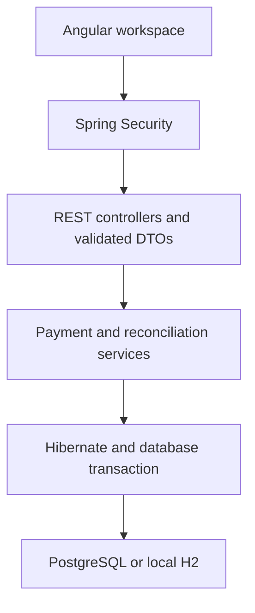
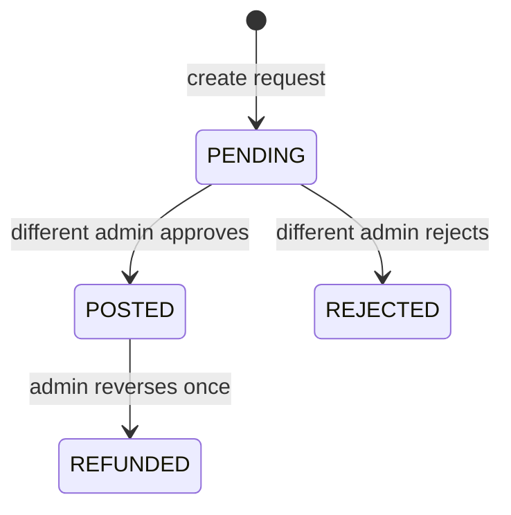

# How LedgerFlow works

## The business problem

A merchant operations team needs to move balances between merchants, control who approves those movements, record the accounting effect and compare internal payments with an external statement. LedgerFlow models that workflow with synthetic USD funds.

This is an internal staff workspace, not a consumer wallet or a full bank. Every signed-in user can read the shared demo merchants; role permissions control mutations. There is no multitenant customer authorization model.

## Application boundaries

The frontend calls relative `/api` URLs. The Angular dev proxy or Nginx forwards them to Java. This keeps authentication and CSRF on the same origin and avoids a permissive cross-origin configuration.

Java classes use one package to keep package-private domain fields, repository interfaces and enums readable for a small learning project. Controllers return DTO records, never JPA entities or password hashes. In a larger team, split by business capability and introduce narrower public interfaces.

## Relational model

| Table | Responsibility |
|---|---|
| `app_users` | Staff identity, BCrypt hash and ADMIN/OPERATOR/VIEWER role |
| `accounts` | Merchant or reserve account, normal balance, cached integer-cent balance and version |
| `transfers` | Request, parties, amount, maker, reviewer, status and idempotency key |
| `journal_entries` | Opening, payment or refund posting header |
| `journal_lines` | Debit/credit lines belonging to a journal entry and account |
| `audit_events` | Actor, action, related record, timestamp and business detail |
| `statement_imports` | File metadata and uploader |
| `statement_rows` | Parsed values and comparison result at import time |

Flyway owns the schema. Hibernate runs with `ddl-auto=validate`, so it checks mappings rather than silently changing tables. Relationships use foreign keys. Monetary values use `BIGINT` cents; API decimal values use `BigDecimal` and must convert exactly. A database check prevents negative merchant balances, and application rules prevent self-transfers and invalid transitions.

## Approval state machine

Only OPERATOR or ADMIN can create. Only ADMIN can decide or refund. A maker cannot decide their own pending payment, including when the maker is an admin. VIEWER cannot mutate data. There is no public user-registration API.

Pending requests do not reserve funds. Available balance is checked at approval time. A second payment can therefore fail approval after another payment has used those funds; the request remains pending and no partial journal or balance changes survive.

## Double-entry example

Merchant balances represent money owed by the platform to merchants, so they are **credit-normal liabilities**. A debit reduces that liability; a credit increases it. The synthetic reserve is debit-normal.

For a $125 payment from Cedar Coffee to Nile Studio:

| Account | Debit | Credit | Merchant balance effect |
|---|---:|---:|---:|
| Cedar Coffee | $125.00 | — | −$125.00 |
| Nile Studio | — | $125.00 | +$125.00 |

Debits equal credits. Total merchant balances are unchanged. Opening synthetic funds debit the reserve and credit a merchant. Refunds create a new reversal entry: debit Nile, credit Cedar. Original entries stay present through the application; there is no edit/delete journal endpoint. A database administrator could still alter records, so this is not a tamper-evident audit system.

## Atomicity and concurrency

Approval runs under Spring `@Transactional`:

1. Obtain a pessimistic write lock on the transfer and check it is still pending.
2. Check the reviewer differs from the maker.
3. Refresh and write-lock the two accounts in sorted UUID order. Refreshing under the lock prevents using an account balance previously loaded before another transaction committed.
4. Check funds, update both integer balances and save equal debit/credit lines.
5. Update transfer status/reviewer/timestamps and write the audit event.
6. Commit everything together. Any failure rolls back the entire operation.

Sorted account locking reduces deadlocks for transfers between the same accounts. Version columns provide another guard against stale updates. Lock or concurrency conflicts return a retryable 409 response rather than exposing database details.

Creation locks the maker's user row before checking `(created_by, idempotency_key)`. That unique pair is also constrained in SQL. Repeating the same key and payload returns the original transfer; changing the payload under the same key returns 409. The frontend keeps its generated key while a request is retried. Approval and refund are guarded by locked state transitions, so repeating them cannot post a second journal entry.

The integration suite checks concurrent approval of one payment and competing payments whose combined amount exceeds funds. PostgreSQL has its own opt-in integration test because H2 compatibility mode is not a substitute for testing PostgreSQL itself.

## Authentication and security

- Spring Security verifies BCrypt hashes and rotates the session at login.
- The session cookie is HttpOnly and SameSite=Lax. The local demo uses HTTP; secure cookies are configurable for HTTPS deployments.
- A readable `XSRF-TOKEN` cookie supplies Angular's `X-XSRF-TOKEN` header for unsafe requests. The CSRF handler supports the plain header token while preserving masked request attributes.
- After login/logout the frontend obtains a fresh token. Login, logout and CSV upload also require CSRF protection.
- Role checks run on the API methods, even if someone bypasses the visible interface.
- DTO validation, page-size limits, CSV limits and controlled error responses protect normal input boundaries.

This is a security learning baseline. It has no production identity provider, MFA, login throttling, customer-level isolation, operational alerting or external security assessment.

## Reconciliation

The statement format is exactly `reference,amount,currency`. The parser accepts UTF-8, including an Excel-style BOM, and rejects malformed amounts/columns and oversized files. A whole file is validated before imports and rows are saved, so malformed files leave no partial import.

For each row, the comparator checks duplicate references in that file, whether a transfer exists, whether it is currently posted, currency and exact amount. Results are snapshots at import time. A later refund does not rewrite an older reconciliation result. Duplicate statements can be uploaded again as a deliberate new comparison; duplicate detection is within each file.

Imports don't move funds or mark bank settlement complete. The sample download includes a real current demo reference plus an unknown record and duplicate to show the comparison behavior.

## Read models and scalability tradeoffs

The overview aggregates the demo dataset and recomputes balances from journal lines, checking both debit/credit equality and agreement with cached account balances. The dashboard uses a repeatable-read transaction to keep that check internally consistent. Posted volume excludes refunded payments and uses UTC posting dates for the seven-day chart.

Some entity relationships are eagerly loaded and import summaries read their rows. This favors a clear small application over high-volume efficiency. Before scaling, introduce SQL aggregate queries, query-specific projections, bounded pagination everywhere, appropriate indexes and measured performance tests. Do not describe this implementation as a high-throughput microservices platform.

## Why PostgreSQL instead of Oracle?

The reviewed market asks for relational SQL broadly, including MySQL, PostgreSQL and some Oracle enterprise stacks. PostgreSQL makes a local portfolio easier to run without an Oracle installation. Hibernate/JPA, SQL modeling, constraints, transactions and locking are transferable concepts, but dialect behavior must still be tested.

An Oracle profile, JDBC driver and compatible migration would be a separate future task. Oracle was not implemented or tested in this delivery.
